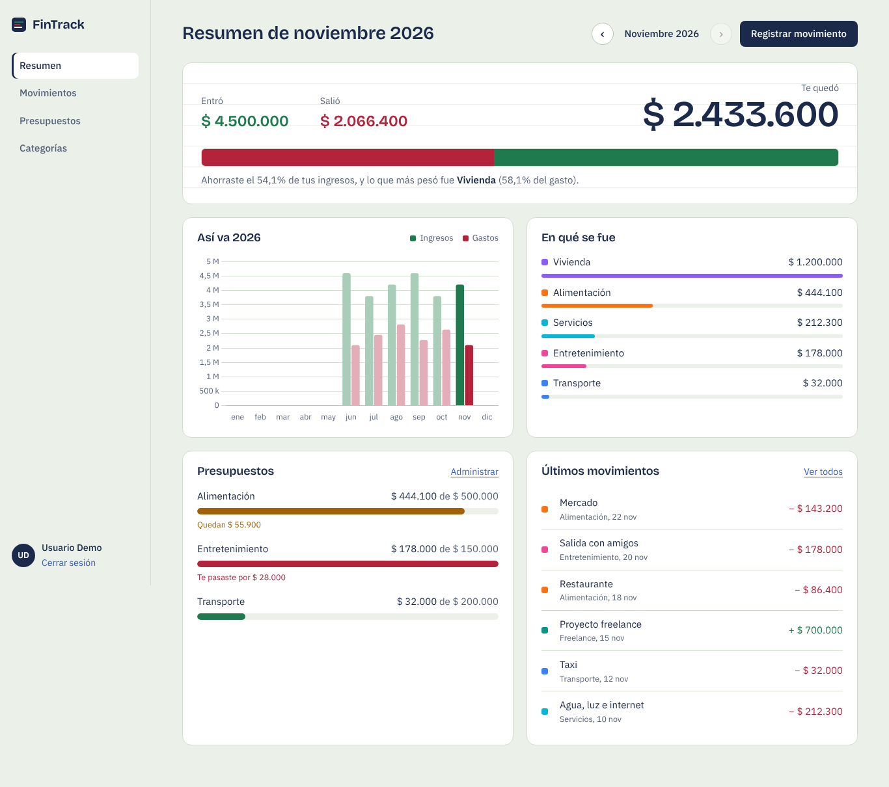
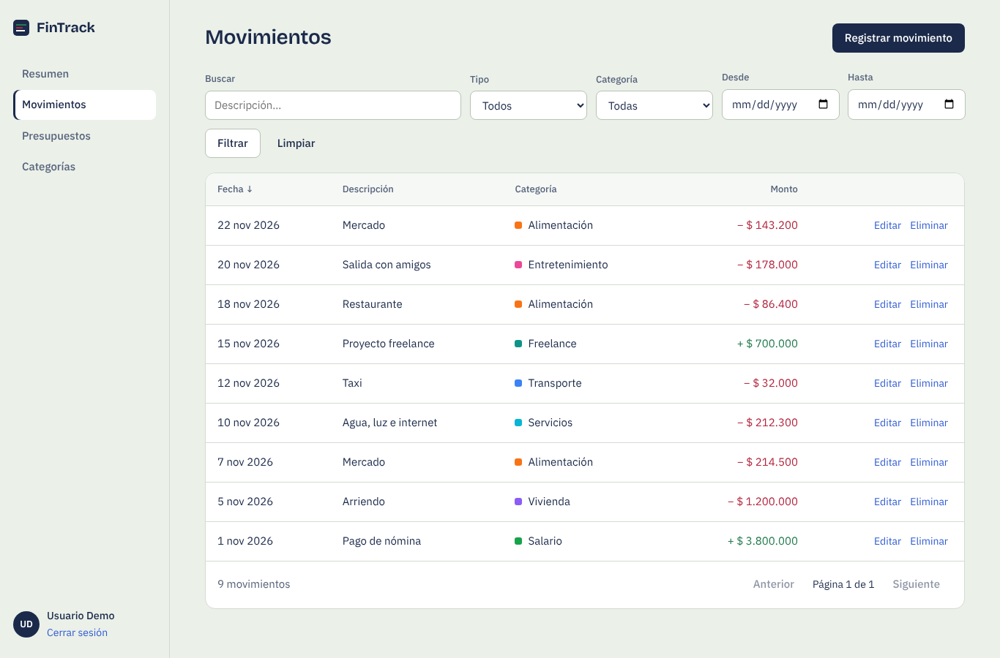
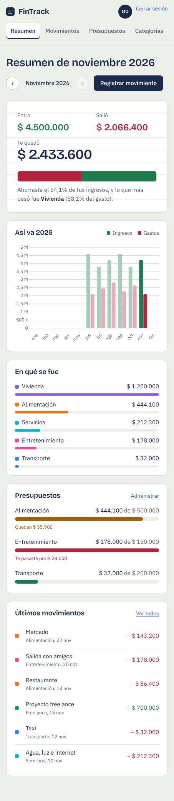

# FinTrack 💸

Aplicación web full-stack para controlar finanzas personales: registra ingresos y gastos, organízalos por categoría, define presupuestos mensuales y mira en un solo panel cuánto ahorraste y en qué se fue tu dinero.




## Funcionalidades

- **Autenticación con JWT**: registro e inicio de sesión. Las contraseñas se guardan con BCrypt.
- **Movimientos**: CRUD de ingresos y gastos con filtros por fecha, tipo, categoría y texto, más paginación y ordenamiento.
- **Categorías**: cada usuario empieza con 10 categorías por defecto y puede crear, editar o eliminar las suyas.
- **Presupuestos mensuales**: límite por categoría de gasto con estado automático: `OK` (menos de 80 %), `WARNING` (80–100 %) y `EXCEEDED` (más de 100 %).
- **Reportes**: balance y tasa de ahorro del mes, distribución del gasto por categoría y comparativo de ingresos y gastos de los 12 meses del año.
- **Aislamiento de datos**: un usuario nunca puede ver ni modificar datos de otro. Está cubierto con tests de integración.
- **Cuenta demo** con 6 meses de datos generados para probar la app al instante.

## Stack técnico

| Capa | Tecnologías |
|---|---|
| Backend | Java 21, Spring Boot 3.5 (Web, Data JPA, Security, Validation, Actuator), JJWT |
| Base de datos | PostgreSQL 16, migraciones con Flyway |
| Frontend | Angular 22 (standalone components, signals, zoneless), Reactive Forms, Chart.js |
| Documentación API | OpenAPI 3 / Swagger UI (springdoc) |
| Tests | JUnit 5, Mockito, MockMvc, H2 (backend) · Vitest (frontend) |
| DevOps | Docker multi-stage, Docker Compose, Nginx, GitHub Actions |

## Arquitectura

```
┌────────────┐      /api/*      ┌──────────────────┐      JPA       ┌────────────┐
│  Angular   │ ───────────────▶ │  Spring Boot API │ ─────────────▶ │ PostgreSQL │
│  (Nginx)   │ ◀─────────────── │  JWT stateless   │ ◀───────────── │  (Flyway)  │
└────────────┘       JSON       └──────────────────┘                └────────────┘
```

El backend está organizado **por funcionalidad** (no por capa técnica). Cada módulo agrupa su controlador, servicio, repositorio, entidad y DTOs:

```
backend/src/main/java/com/fintrack/
├── auth/          registro, login, perfil
├── category/      categorías de ingreso/gasto
├── transaction/   movimientos + filtros dinámicos (JPA Specifications)
├── budget/        presupuestos mensuales y su estado
├── report/        resumen, distribución por categoría, serie mensual
├── security/      filtro JWT y servicio de tokens
├── config/        seguridad, CORS, OpenAPI
├── common/        manejo global de errores, respuesta paginada
└── seed/          datos de demostración
```

Algunas decisiones de diseño:

- **DTOs como `record`** y entidades sin setters públicos: los cambios pasan por métodos con intención (`update`, `updateLimit`).
- **Errores consistentes**: un `@RestControllerAdvice` devuelve siempre el mismo formato JSON (`status`, `message`, `fieldErrors`).
- **Sin N+1**: `@EntityGraph` en las consultas paginadas y agregaciones con JPQL (`sum`, `group by`) en lugar de calcular en memoria.
- **El tipo del movimiento lo define su categoría**, así un gasto no se puede registrar como ingreso por error.
- **El esquema lo controla Flyway** (`ddl-auto: none`) y queda versionado como código.

## Cómo ejecutarlo

### Opción 1: Docker (recomendado)

Requisitos: Docker y Docker Compose.

```bash
git clone https://github.com/TU_USUARIO/fintrack.git
cd fintrack
docker compose up --build
```

| Servicio | URL |
|---|---|
| Aplicación | http://localhost:4200 |
| Swagger UI | http://localhost:8080/swagger-ui.html |
| Health check | http://localhost:8080/actuator/health |

Entra con la cuenta demo: **demo@fintrack.dev** / **Demo1234**. También puedes usar el botón "Probar con la cuenta demo" en la pantalla de inicio.

### Opción 2: en local, sin Docker

Requisitos: Java 21, Maven 3.9+, Node 22+ y PostgreSQL 16.

```bash
# 1. Base de datos
createdb fintrack   # usuario/contraseña por defecto: fintrack/fintrack (configurable con DB_USER/DB_PASSWORD)

# 2. Backend (puerto 8080)
cd backend
SEED_DEMO=true mvn spring-boot:run

# 3. Frontend (puerto 4200, redirige /api al backend con proxy.conf.json)
cd frontend
npm install
npm start
```

### Variables de entorno del backend

| Variable | Por defecto | Descripción |
|---|---|---|
| `DB_URL` | `jdbc:postgresql://localhost:5432/fintrack` | URL JDBC |
| `DB_USER` / `DB_PASSWORD` | `fintrack` / `fintrack` | Credenciales de la base de datos |
| `JWT_SECRET` | clave de desarrollo | Clave HMAC en Base64 (mínimo 256 bits). **Cámbiala en producción.** |
| `JWT_EXPIRATION_MINUTES` | `1440` | Duración del token |
| `CORS_ALLOWED_ORIGINS` | `http://localhost:4200` | Orígenes permitidos |
| `SEED_DEMO` | `false` | Crea el usuario demo al arrancar |

## Tests

```bash
cd backend && mvn verify                       # unitarios (*Test) + integración (*IT)
cd frontend && npx ng test --watch=false       # Vitest
```

Los tests de integración levantan la aplicación completa con H2 y prueban flujos reales por HTTP: registro y login, validaciones, tokens inválidos, cálculos de reportes y presupuestos, y que un usuario no pueda acceder a los datos de otro.

El pipeline de **GitHub Actions** corre todos los tests y construye las imágenes Docker en cada push.

## Endpoints principales

| Método | Ruta | Descripción |
|---|---|---|
| POST | `/api/auth/register` | Crear cuenta |
| POST | `/api/auth/login` | Obtener JWT |
| GET | `/api/auth/me` | Usuario actual |
| GET/POST/PUT/DELETE | `/api/categories` | Categorías |
| GET | `/api/transactions?from=&to=&type=&categoryId=&search=&page=&size=&sort=` | Movimientos con filtros |
| POST/PUT/DELETE | `/api/transactions` | Crear, editar y eliminar movimientos |
| GET | `/api/budgets?year=&month=` | Presupuestos del mes con lo gastado |
| POST/PUT/DELETE | `/api/budgets` | Gestionar presupuestos |
| GET | `/api/reports/summary` | Ingresos, gastos, balance y tasa de ahorro |
| GET | `/api/reports/by-category` | Distribución por categoría |
| GET | `/api/reports/monthly?year=` | Serie de 12 meses |

La documentación interactiva completa está en Swagger UI.

## Capturas

| Movimientos | Móvil |
|---|---|
|  |  |

## Próximas mejoras

- Movimientos recurrentes (arriendo, suscripciones)
- Exportar a CSV o Excel
- Refresh tokens
- Tests end-to-end con Playwright

## Autora

**Emili García Bermúdez**, estudiante de Ingeniería de Sistemas de la Universidad del Quindío.
[LinkedIn](https://www.linkedin.com/in/emili-garcia-48a6b0374/) · [GitHub](https://github.com/Emili65)

Licencia MIT.
